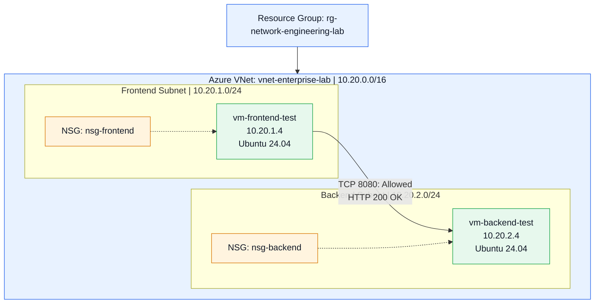

# Azure Enterprise Network Architecture

## Architecture Overview

This diagram documents the Azure enterprise networking lab deployed in East US.

The environment demonstrates subnet segmentation, network security groups, private connectivity, and application-level testing.

## Network Topology

## Security Configuration

- Frontend and backend workloads are deployed in separate subnets.
- Network Security Groups are associated with their respective subnets.
- Backend TCP port 8080 is permitted from the frontend subnet.
- Other inbound traffic originating within the lab VNet is denied by the backend NSG.
- Neither test VM has a public IP address.

## Connectivity Validation

| Test | Result |
|---|---|
| Frontend inbound TCP 8080 | Allowed |
| Frontend external inbound SSH | Denied |
| Backend inbound TCP 8080 | Allowed |
| Backend inbound SSH | Denied |
| Frontend to backend HTTP connectivity | HTTP 200 OK |

Azure Network Watcher IP Flow Verify was used to evaluate selected security rules.

Application-level connectivity was independently validated using a Python HTTP server.

## Resource Lifecycle

Both test virtual machines were stopped and deallocated after testing to reduce Azure consumption.

The network configuration and evidence are retained for documentation and future exercises.